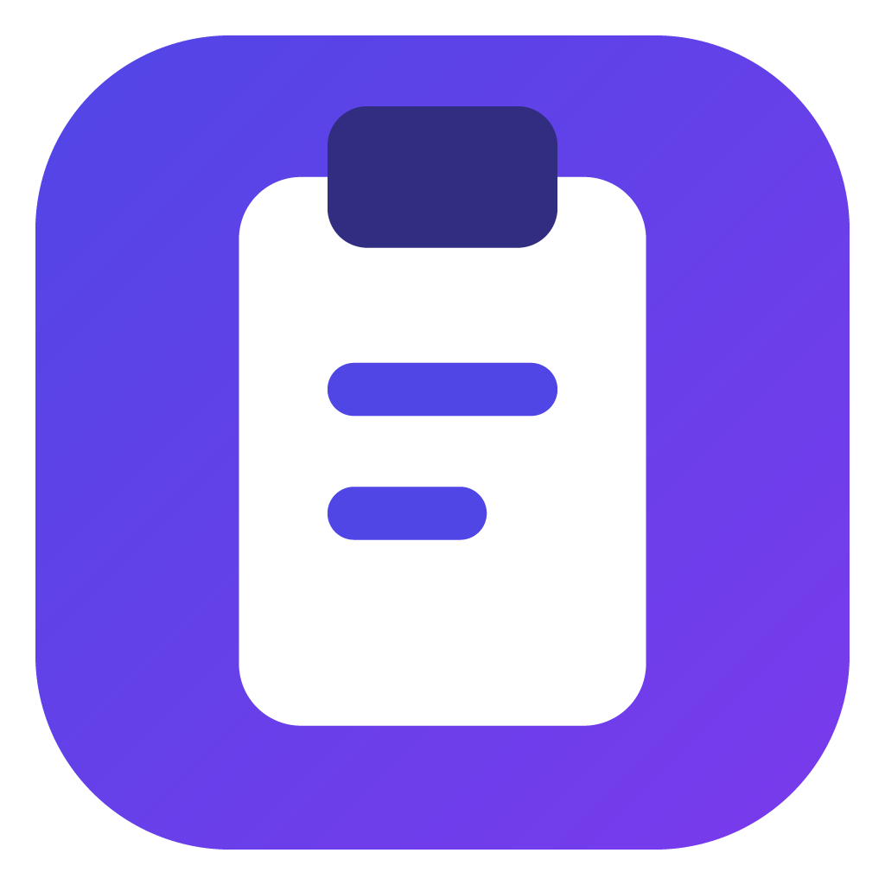
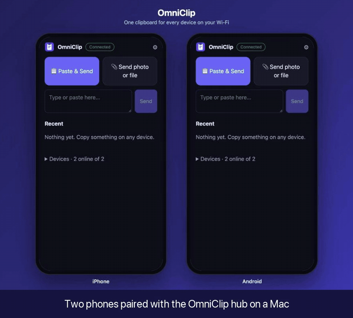
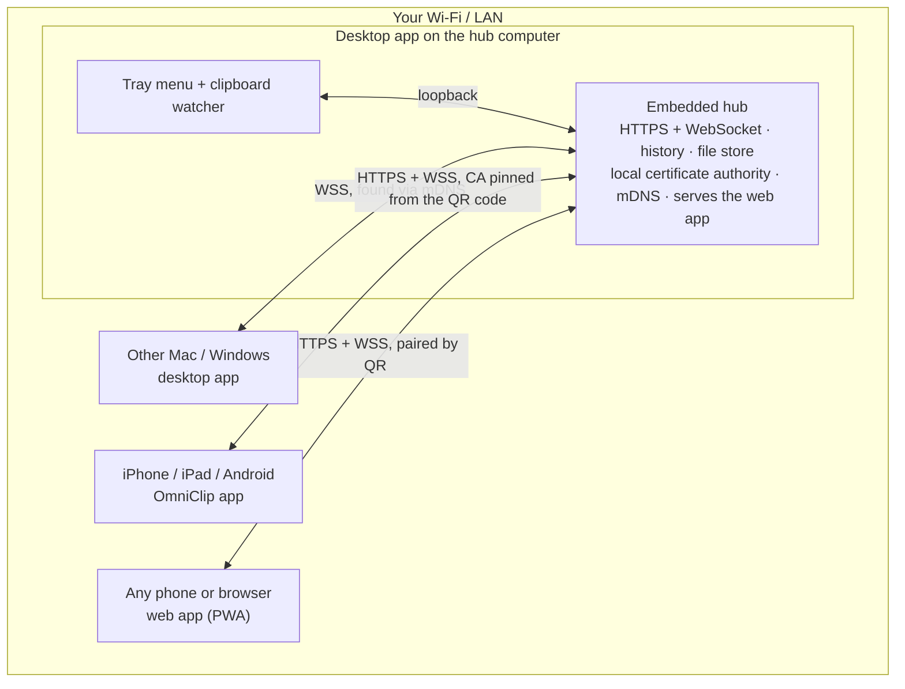
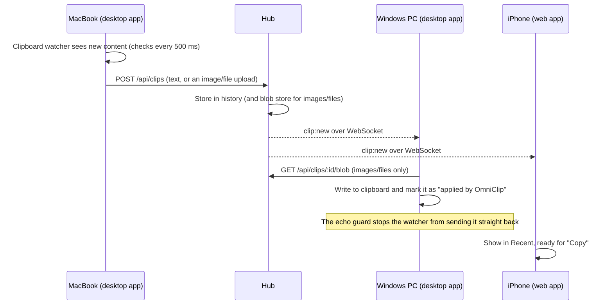
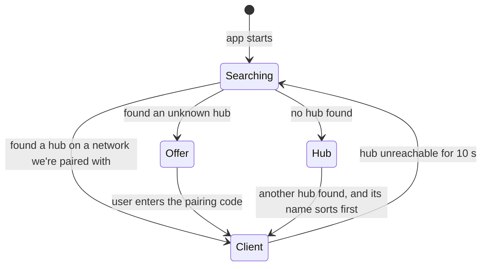

<div align="center">



# OmniClip

**One clipboard for every device on your Wi-Fi.**

Copy on your MacBook and paste on your iPhone. Share a photo from Android and paste it on Windows.
Drop a file on the Mac and pick it up on the iPad. No cloud, no account, no app store.


[](LICENSE)



<sub>Text from a MacBook, a note typed on an iPhone, and a photo all appear on every paired device in real time. <a href="docs/demo.mp4">Watch as MP4</a></sub>

<br><br>

**[⬇️ Download for Mac, Windows, Android and iPhone](https://github.com/karammm/omniclip/releases/latest)**

</div>

---

## Contents

- [Why OmniClip](#why-omniclip)
- [Features](#features)
- [Supported devices](#supported-devices)
- [Install](#install)
- [Quick start](#quick-start)
- [Everyday use](#everyday-use)
- [How it works](#how-it-works)
- [Security and privacy](#security-and-privacy)
- [HTTP API](#http-api)
- [Configuration and storage](#configuration-and-storage)
- [Development](#development)
- [Releases and building installers](#releases-and-building-installers)
- [Troubleshooting](#troubleshooting)
- [Known limitations](#known-limitations)
- [Roadmap](#roadmap)
- [Contributing](#contributing)
- [License](#license)

## Why OmniClip

Apple's Universal Clipboard only works between Apple devices. Windows' clipboard sync only works with a Microsoft account and Android. Cloud clipboard apps send everything you copy, including passwords and private messages, to someone else's server.

OmniClip connects **all** of your devices instead, and keeps your data **at home**. One of your computers acts as a small local server (the *hub*). Every other device talks to it directly over your Wi-Fi. Nothing ever leaves your network.

## Features

| | |
| --- | --- |
| 🔄 **Automatic desktop sync** | On Mac and Windows, copy as usual and paste on the other computer. No buttons. |
| 📱 **Apps for every device** | Mac `.dmg`, Windows `.exe`/`.msi`, an Android app and an iPhone/iPad app. No app store needed. |
| 📷 **Pair by scanning a QR code** | Open the OmniClip app on your phone, tap **Scan QR code**, done. |
| ⚡ **Auto-send on Android** | Copy something, open OmniClip, and it's already on your computer. |
| 🖼️ **Text, links, images and files** | Images go straight onto the desktop clipboard. Files are saved to `Downloads/OmniClip`. |
| 📁 **Copy files in Finder or Explorer** | Press ⌘C or Ctrl+C on files and they're sent to your other devices. |
| ⬆️ **Automatic updates** | Windows installs updates in the background. Mac tells you when a new version is out. |
| 🕘 **History** | Your last 200 clips. Click any of them to copy it again. |
| 📤 **Share sheet integration** | Android: **Share → OmniClip** from any app. iOS: a one-tap Shortcut, including Back Tap. |
| 🧭 **Zero configuration** | Computers find each other automatically over mDNS (Bonjour). |
| 🛟 **Automatic failover** | If the hub computer shuts down, another desktop takes over within about 10 seconds, and phones find it on their own. |
| 🔐 **Private by design** | Pairing codes, a token per device, encryption with a certificate pinned from the QR code, and per-device revocation. |

## Supported devices

| Device | How it joins | Sending | Receiving |
| --- | --- | --- | --- |
| **Mac** (macOS 12+) | Menu-bar app | Automatic: just copy | Automatic: just paste |
| **Windows** 10/11 | System-tray app | Automatic: just copy | Automatic: just paste |
| **Android** 8+ | OmniClip app (`.apk`) | Opening the app sends your clipboard automatically, or **Share → OmniClip** | Tap **Copy** |
| **iPhone / iPad** | OmniClip app (`.ipa` / Xcode) | **Paste & Send**, or a one-tap Shortcut | Tap **Copy** |
| Anything with a browser | Web app served by the hub | **Paste & Send**, or paste into the text box | Tap **Copy** |

> [!NOTE]
> All devices must be on the **same Wi-Fi or LAN**. Guest networks that isolate clients from each other block local connections.

## Install

Download everything from the **[latest release](https://github.com/karammm/omniclip/releases/latest)**.

| Device | File | First launch |
| --- | --- | --- |
| **Mac**, Apple Silicon (M1–M4) | `OmniClip-<version>-mac-arm64.dmg` | See *macOS* below |
| **Mac**, Intel | `OmniClip-<version>-mac-x64.dmg` | See *macOS* below |
| **Windows**, home PCs | `OmniClip-Setup-<version>-x64.exe` | See *Windows* below |
| **Windows**, managed PCs | `OmniClip-<version>-x64.msi` | Deploy with Intune, Group Policy or `msiexec /i` |
| **Android** | `OmniClip-<version>-android.apk` | See *Android* below |
| **iPhone / iPad** | `OmniClip-<version>-ios-unsigned.ipa` | See *iPhone and iPad* below |

The apps aren't signed by Apple or Microsoft yet, which costs money every year. Your device shows a warning the first time, and you only have to get past it once.

<details>
<summary><b>macOS</b></summary>

1. Open the `.dmg` and drag **OmniClip** into **Applications**.
2. Open OmniClip. macOS says it can't verify the app. Click **Done**.
3. Open **System Settings → Privacy & Security**, scroll down, and click **Open Anyway** next to OmniClip.
4. Allow **Local Network** access when macOS asks.

Or run this once in Terminal instead of steps 2–3: `xattr -dr com.apple.quarantine /Applications/OmniClip.app`
</details>

<details>
<summary><b>Windows</b></summary>

1. Run `OmniClip-Setup-<version>-x64.exe`.
2. At the blue **Windows protected your PC** screen, click **More info → Run anyway**.
3. When Windows Firewall asks, allow OmniClip on **Private networks**.
</details>

<details>
<summary><b>Android</b></summary>

1. Download the `.apk` on your phone, or send it to the phone.
2. Open it. Android asks you to allow installs from your browser or file manager. Allow it, then tap **Install**.
3. If Play Protect warns about an unknown app, tap **Install anyway**.
</details>

<details>
<summary><b>iPhone and iPad</b></summary>

Apple only allows apps from the App Store unless you sign them yourself. That's free with an Apple ID, and there are two ways to do it:

- **Sideloadly or AltStore (no Mac needed for Sideloadly).** Install [Sideloadly](https://sideloadly.io), connect your iPhone, drag in `OmniClip-<version>-ios-unsigned.ipa` and sign in with your Apple ID. On the phone, trust the developer profile in **Settings → General → VPN & Device Management**.
- **Xcode (on a Mac).** Run `npm run ios -w @omniclip/mobile` from a clone of this repo. In Xcode, choose your iPhone, set **Signing & Capabilities → Team** to your Apple ID, and press **Run**.

Apps signed with a free Apple ID stop opening after 7 days. Reinstall, or refresh in Sideloadly or AltStore, to keep using it. A paid Apple Developer account removes this limit.

You can also skip the app and use the [web app](#web-app-no-install) in Safari.
</details>

## Quick start

### 1. Install the desktop app

Install OmniClip on at least one Mac or Windows PC (see [Install](#install)), then open it. The OmniClip window opens, and a clipboard icon appears in the menu bar (Mac) or system tray (Windows).

The first computer you start becomes the **hub** automatically.

> [!TIP]
> Can't see the menu-bar icon? MacBooks hide extra icons behind the notch. Open OmniClip again from Applications to bring its window back.

### 2. Pair a phone or tablet

**With the OmniClip app (recommended)**

1. On the computer, the OmniClip window shows a QR code. You can also open it from the tray menu with **Pair a phone or tablet…**.
2. Open the OmniClip app on your phone and tap **📷 Scan QR code**. Done.

No camera? Tap **Enter the code instead**, then type the hub address and the 6-digit code shown in the window.

#### Web app (no install)

1. Scan the QR code with the phone's normal camera app. A setup page opens in the browser.
2. Follow the setup page. You only do this once per phone:
   - **Install the OmniClip certificate.** Browsers only allow clipboard access over HTTPS, and this certificate lets your phone trust your hub.
     - *iPhone/iPad:* download the profile, install it in **Settings → Profile Downloaded**, then turn it on in **Settings → General → About → Certificate Trust Settings**.
     - *Android:* download the certificate and install it in **Settings → Security & privacy → More security settings → Install from device storage → CA certificate**. The wording varies by phone, so searching Settings for "certificate" helps.
   - Open the secure link and tap **Pair this device**.
   - Add it to your Home Screen. *iOS:* Share → **Add to Home Screen**. *Android:* ⋮ → **Install app**.

> [!TIP]
> Can't install the certificate, for example on a work-managed phone? Choose **basic mode** on the setup page. It runs over plain HTTP. Copying still works with one tap. To send, paste into the text box instead of using **Paste & Send**.

### 3. Add another computer

Launch OmniClip on the second computer. It finds the hub on your network and shows a notification. Choose **Join …** from its tray menu and enter the 6-digit code from the hub's pairing window. Both computers now share one clipboard.

## Everyday use

### On a Mac or Windows PC

Just copy and paste. That includes files: select them in Finder or Explorer and press ⌘C or Ctrl+C. Up to 20 files and 100 MB are sent automatically; for bigger sets use **Send file…**. Folders are skipped.

The tray menu also gives you:

| Menu item | What it does |
| --- | --- |
| **Recent** | Your latest clips. Click one to put it back on this computer's clipboard. |
| **Send file…** | Sends a file to every device. On a Mac you can also drag files onto the menu-bar icon. |
| **Pair a phone or tablet…** | Shows the QR code and pairing code (hub only). |
| **Devices** | Every paired device and whether it's online. Choose **Remove** to revoke one. |
| **Pause syncing** | Temporarily stops sending and receiving. |
| **Open at login** | Starts OmniClip automatically. |
| **Check for updates** | Looks for a new version now. OmniClip also checks every 6 hours. |

Files received from other devices are saved to `~/Downloads/OmniClip` (Windows: `Downloads\OmniClip`), and a notification appears.

### On a phone or tablet

- **Paste & Send** reads your clipboard and sends it to every device. iOS asks you to confirm with a **Paste** button. That's normal.
- **Send photo or file** opens the picker.
- **Type or paste here** sends text you type.
- Every clip in **Recent** has a **Copy** button. Images and files also have **Save / Share** (app) or **Download** and **Share** (web app).
- **If the hub computer goes away**, the app shows **Looking for hub…**. It checks the other desktops and your local network, then reconnects to whichever computer took over.
- **Android app:** copy something in any app, then open OmniClip, and it's sent automatically. You can also use **Share → OmniClip** from any app, for text, photos or files.
- **iPhone app:** turn on automatic sending in **⚙︎ Settings** in the app. To stop iOS asking each time, go to **Settings → Apps → OmniClip → Paste from Other Apps → Allow**.

### iPhone one-tap Shortcut (optional)

iOS never lets web apps read the clipboard in the background. A Shortcut gets you as close as possible: one tap, or a double-tap on the back of the phone.

1. In OmniClip, open **⚙︎ Setup** (secure mode) and reveal your device's **URL** and **token**.
2. In the **Shortcuts** app, create a new shortcut with two actions:
   1. **Get Clipboard**
   2. **Get Contents of URL**
      - URL: `https://<hub-ip>:7878/api/clips`
      - Method: **POST**
      - Header: `Authorization` = `Bearer <your token>`
      - Request Body: **File**, set to *Clipboard*
3. Turn on **Show in Share Sheet**, or assign it in **Settings → Accessibility → Touch → Back Tap → Double Tap**.

The Shortcut works for both text and images.

## How it works

### Architecture



Every desktop runs the same app. One of them hosts the hub, and the rest connect to it as clients, exactly like the phones. The hub's own tray app also connects as a client over loopback, so every device follows the same code path.

### What happens when you copy



### Choosing the hub, and failover



- **Discovery.** Hubs advertise themselves over mDNS as `_omniclip._tcp`, with the network ID and hub name.
- **Replication.** The hub shares its device registry (hashed tokens) and its certificate authority with every paired desktop. That lets any desktop take over **with the same identity**: existing devices and tokens keep working, and phones keep trusting the certificate.
- **Split brain.** If two hubs ever exist on the same network, for example after a Wi-Fi drop, the one whose name sorts later steps down and rejoins as a client.

### Tech stack

| Part | Built with |
| --- | --- |
| Shared protocol | TypeScript + [zod](https://zod.dev) schemas (`packages/protocol`) |
| Hub | [Fastify 5](https://fastify.dev), `@fastify/websocket`, `@fastify/multipart`, JSON file store, [node-forge](https://github.com/digitalbazaar/forge) for certificates, [bonjour-service](https://github.com/onlxltd/bonjour-service) for mDNS |
| Web app | [Preact](https://preactjs.com) + [Vite](https://vite.dev), service worker, Web Share Target (about 37 KB gzipped) |
| Desktop | [Electron 45](https://www.electronjs.org), bundled with esbuild, packaged with electron-builder |
| Mobile | [Capacitor 8](https://capacitorjs.com) wrapping the web UI, plus a small native Android plugin (share inbox, image copy) |
| Releases | GitHub Actions: `.dmg`, `.exe`, `.msi`, `.apk` and `.ipa` from one tag |
| Tests | [Vitest](https://vitest.dev) plus an end-to-end script with a real TLS hub and simulated devices |

## Security and privacy

- **Local only.** OmniClip has no servers, telemetry or analytics. Clips travel only between your devices.
- **Pairing.** A device joins with a 6-digit one-time code. The code changes after every use, every 10 minutes, and after 10 wrong attempts.
- **Per-device tokens.** Each paired device gets its own random token. The hub only stores a SHA-256 hash of it. Remove a device from **Devices** and it's disconnected immediately.
- **Encryption.** All secure-mode traffic uses TLS. Each OmniClip network generates its own private certificate authority. Its server certificate covers the hub's LAN addresses and is valid for at most 397 days, so Apple devices accept it.
- **Desktops verify the hub.** After pairing, desktops pin the network's certificate authority and reject any other server.
- **The phone apps pin the hub's certificate.** The pairing QR code contains a fingerprint of your network's certificate authority. The app checks the hub's certificate against it before pairing, and from then on trusts only that authority, for every request and the live connection. That's why the apps don't need the certificate install. A typed-in hub address (no QR code) trusts the hub the first time it connects.
- **Basic mode** in the web app uses plain HTTP on port 7879. It isn't encrypted, so use it only on networks you trust. Port 7879 also serves the setup page, `/api/info` and the CA certificate, all of which are public.

> [!IMPORTANT]
> Anything you copy on a synced desktop is sent to your other devices, passwords included. Use **Pause syncing** before copying something you don't want shared.

## HTTP API

The hub has a small REST API, handy for scripts, Shortcuts, Tasker or automation tools. Authenticate with `Authorization: Bearer <token>`, or add `?token=<token>` for links and WebSockets.

| Method | Path | Description |
| --- | --- | --- |
| `GET` | `/api/info` | Hub identity and protocol version. No authentication. |
| `GET` | `/ca.crt` | The network's CA certificate. No authentication. |
| `POST` | `/api/pair` | `{code, name, platform}` → `{token, deviceId, networkId, caPem}` |
| `GET` | `/api/me` | The device the token belongs to |
| `GET` | `/api/devices` | Paired devices and their online status |
| `GET` | `/api/clips?limit=N` | Clip history, newest first |
| `POST` | `/api/clips` | Send a clip (see the formats below) |
| `GET` | `/api/clips/:id/blob` | Download an image or file clip |
| `GET` | `/ws` | WebSocket: `hello`, `clip:new`, `devices`, `revoked` events |

`POST /api/clips` accepts:

```bash
# Text (JSON)
curl -X POST https://HUB:7878/api/clips --cacert omniclip-ca.crt \
  -H "Authorization: Bearer $TOKEN" -H "Content-Type: application/json" \
  -d '{"text": "Hello from the terminal"}'

# Text (raw body)
curl -X POST https://HUB:7878/api/clips --cacert omniclip-ca.crt \
  -H "Authorization: Bearer $TOKEN" -H "Content-Type: text/plain" --data-binary @notes.txt

# Image or file (multipart). Add -F kind=file before the file to force "file" over "image".
curl -X POST https://HUB:7878/api/clips --cacert omniclip-ca.crt \
  -H "Authorization: Bearer $TOKEN" -F "file=@screenshot.png"

# Raw binary body, with an optional filename
curl -X POST https://HUB:7878/api/clips --cacert omniclip-ca.crt \
  -H "Authorization: Bearer $TOKEN" -H "Content-Type: application/pdf" \
  -H "X-Filename: report.pdf" --data-binary @report.pdf
```

Message schemas live in [`packages/protocol/src/index.ts`](packages/protocol/src/index.ts).

## Configuration and storage

| Setting | Value |
| --- | --- |
| Secure port (HTTPS + WSS) | `7878` |
| Setup / basic-mode port (HTTP) | `7879` |
| mDNS service | `_omniclip._tcp` |
| History | 200 clips |
| File and image storage | 1 GB, oldest deleted first |
| Largest text clip | 1 MB |
| Largest upload | 200 MB |

Hub data, certificates and stored files live in the app's user-data folder:

- **macOS:** `~/Library/Application Support/OmniClip`
- **Windows:** `%APPDATA%\OmniClip`

Delete that folder to reset OmniClip completely. You'll need to pair every device again.

## Development

### Prerequisites

- **Node.js 22.12 or newer** (developed on Node 24) and npm
- macOS or Windows to run the desktop app. The hub and web app also run on Linux.

### Setup

```bash
git clone https://github.com/karammm/omniclip.git
cd omniclip
npm install
node node_modules/electron/install.js   # npm 11 blocks Electron's download script, so run it once by hand
```

### Scripts

| Command | What it does |
| --- | --- |
| `npm run dev:desktop` | Builds the web app, bundles the Electron app and launches it in the tray |
| `npm run dev:hub` | Runs a standalone hub in the terminal and prints a pairing QR code (no Electron needed) |
| `npm run build:web` | Builds the PWA into `apps/web/dist` |
| `npm test` | Unit and integration tests (Vitest) |
| `npm run test:e2e` | Starts a real TLS hub and three simulated devices that exchange text, images and files |
| `npm run typecheck` | Type-checks every workspace |
| `npm run icons` | Regenerates the app, tray and PWA icons |
| `npm run dist:mac` / `dist:win` | Builds desktop installers (see below) |
| `npm run build -w @omniclip/mobile` | Builds the app bundle and syncs it into the Android and iOS projects |
| `npm run android -w @omniclip/mobile` | Builds, then opens the project in Android Studio |
| `npm run ios -w @omniclip/mobile` | Builds, then opens the project in Xcode |
| `node scripts/set-version.mjs 1.2.3` | Sets one version in every package and both mobile projects |

> [!TIP]
> In development builds, the desktop app also prints the current pairing code to the terminal.

### Project structure

```
omniclip/
├── packages/
│   └── protocol/        Shared zod schemas, types and constants
├── apps/
│   ├── hub/             Fastify HTTPS/WebSocket server, JSON store, local CA, mDNS
│   ├── web/             Preact UI: the PWA and (with --mode native) the mobile apps
│   ├── desktop/         Electron tray app: hub election and failover, clipboard watcher, pairing window
│   └── mobile/          Capacitor Android and iOS projects, plus the share-inbox and image-copy plugin
├── .github/workflows/   CI and the release pipeline
├── scripts/             Icon generator, version setter, end-to-end test
└── docs/                README media
```

### Testing

The test suite covers protocol validation, pairing and code rotation, auth, broadcast, raw uploads, revocation, TLS, history pruning, hub election and the echo guard. The end-to-end script runs the full stack over real TLS:

```bash
npm test && npm run test:e2e
```

## Releases and building installers

### Publishing a release

Every installer is built by GitHub Actions ([`release.yml`](.github/workflows/release.yml)). To publish a version:

```bash
git tag v0.2.0
git push origin v0.2.0
```

About 15 minutes later, a GitHub Release appears with the Mac `.dmg` files, the Windows `.exe` and `.msi`, the Android `.apk` and the unsigned iOS `.ipa`. The version number comes from the tag. You can also run the workflow by hand from the **Actions** tab to build files without publishing.

**Android signing.** For installed apps to update cleanly, every release must be signed with the same key. Add these repository secrets (**Settings → Secrets and variables → Actions**):

| Secret | Value |
| --- | --- |
| `ANDROID_KEYSTORE_BASE64` | `base64 -i omniclip.jks` |
| `ANDROID_KEYSTORE_PASSWORD` | Keystore password |
| `ANDROID_KEY_ALIAS` | Key alias |
| `ANDROID_KEY_PASSWORD` | Key password |

Create the key once with `keytool -genkeypair -v -keystore omniclip.jks -alias omniclip -keyalg RSA -keysize 4096 -validity 10000`, and keep a backup. If you lose it, users have to uninstall before they can update. Without these secrets, the APK is signed with a temporary key.

### Building on your own machine

```bash
npm run dist:mac                     # → apps/desktop/release/OmniClip-<version>-mac-{arm64,x64}.dmg
npm run dist:win                     # → .exe and .msi (run this on Windows)
npm run apk -w @omniclip/mobile      # → apps/mobile/android/app/build/outputs/apk/release/ (needs JDK 21 + Android SDK)
npm run ios -w @omniclip/mobile      # opens Xcode; press Run to install on your iPhone
```

## Troubleshooting

<details>
<summary><b>The phone says it can't reach the hub</b></summary>

- Make sure the phone and the computer are on the **same Wi-Fi network**, not a guest network.
- Check that the computer's firewall allows OmniClip on ports **7878** and **7879**. On Windows, the network must be set to **Private**.
- If the hub computer's IP address changed, open **Pair a phone or tablet…** again and rescan the QR code.
</details>

<details>
<summary><b>"Paste & Send" is greyed out or does nothing</b></summary>

Browsers only allow clipboard reading over HTTPS. Install the certificate as described on the setup page, then open the **secure** link (`https://…:7878`). In basic mode, paste into the text box instead.
</details>

<details>
<summary><b>The iPhone still shows a certificate warning</b></summary>

Installing the profile isn't enough on iOS. Also turn it on under **Settings → General → About → Certificate Trust Settings**.
</details>

<details>
<summary><b>The second computer doesn't find the hub</b></summary>

Choose **Search again** in the tray menu if it appears, or restart OmniClip. Some routers block mDNS/Bonjour between wired and wireless clients, or between 2.4 GHz and 5 GHz bands. Put both computers on the same band, or turn on multicast/IGMP snooping support in your router.
</details>

<details>
<summary><b>Copying a file in Finder or Explorer doesn't sync</b></summary>

That's expected in v0.1. Use **Send file…** or drag the file onto the menu-bar icon.
</details>

## Known limitations

- **iOS needs a tap** to send and to copy. Apple doesn't allow background clipboard access. That's an iOS rule, not an OmniClip choice.
- **The web app after a failover** has to be opened at the new hub's address. The phone apps and desktops move over automatically.
- **The iPhone app** needs re-signing every 7 days with a free Apple ID, and it isn't on the App Store.
- **Wi-Fi/LAN only.** There's no Bluetooth or internet relay yet.
- **Copied folders** aren't sent. Zip them first, or send the files inside.
- **Automatic updates on Mac** only notify you. Installing silently needs a signed app.
- **Unsigned installers.** Each platform shows a warning the first time (see [Install](#install)).

## Roadmap

- [x] Mac, Windows, Android and iOS apps, built automatically on every release
- [ ] Signed and notarized installers (silent updates on Mac too)
- [ ] App Store and Google Play listings
- [x] Phones that follow the hub automatically after a failover
- [x] Automatic sync of files copied in Finder and Explorer
- [x] TLS with certificate pinning in the phone apps
- [x] Automatic updates (Windows), update notifications (Mac)
- [ ] Linux desktop build
- [ ] End-to-end encryption of stored history
- [ ] Optional Bluetooth for nearby devices without Wi-Fi

## Contributing

Issues and pull requests are welcome.

1. Fork the repository and create a branch.
2. Make your change and add tests where it makes sense.
3. Run `npm run typecheck && npm test && npm run test:e2e`.
4. Open a pull request that describes what you changed and how you tested it.

By contributing, you agree that your contributions are licensed under the MIT License.

## License

OmniClip is released under the [MIT License](LICENSE). You are free to use, copy, modify, merge, publish, distribute, sublicense and sell copies of it, as long as the copyright and license notice are kept. The software comes with no warranty.

---

<div align="center">
<sub>Built with TypeScript, Fastify, Preact and Electron. Your clipboard never leaves your home.</sub>
</div>
